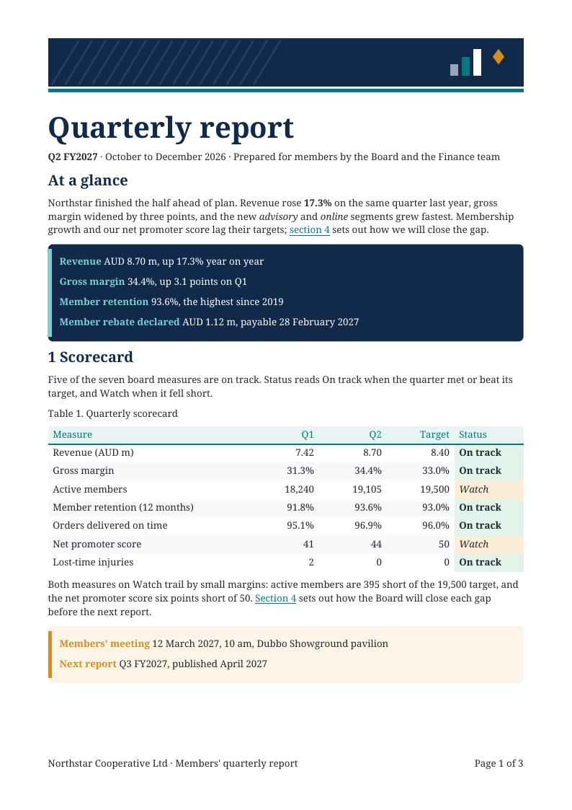
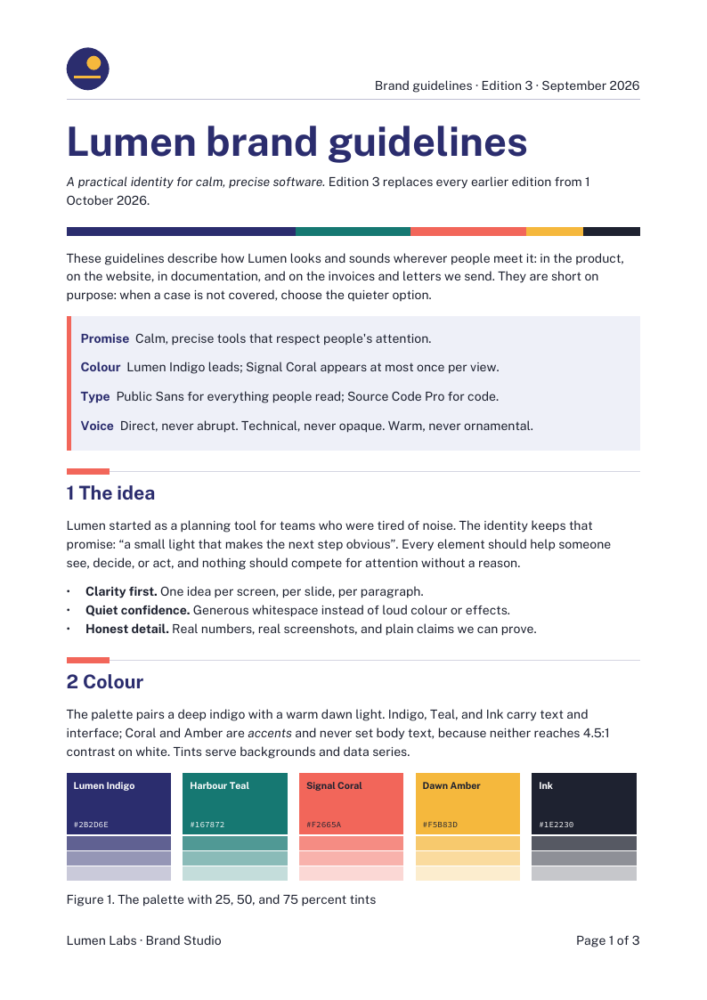
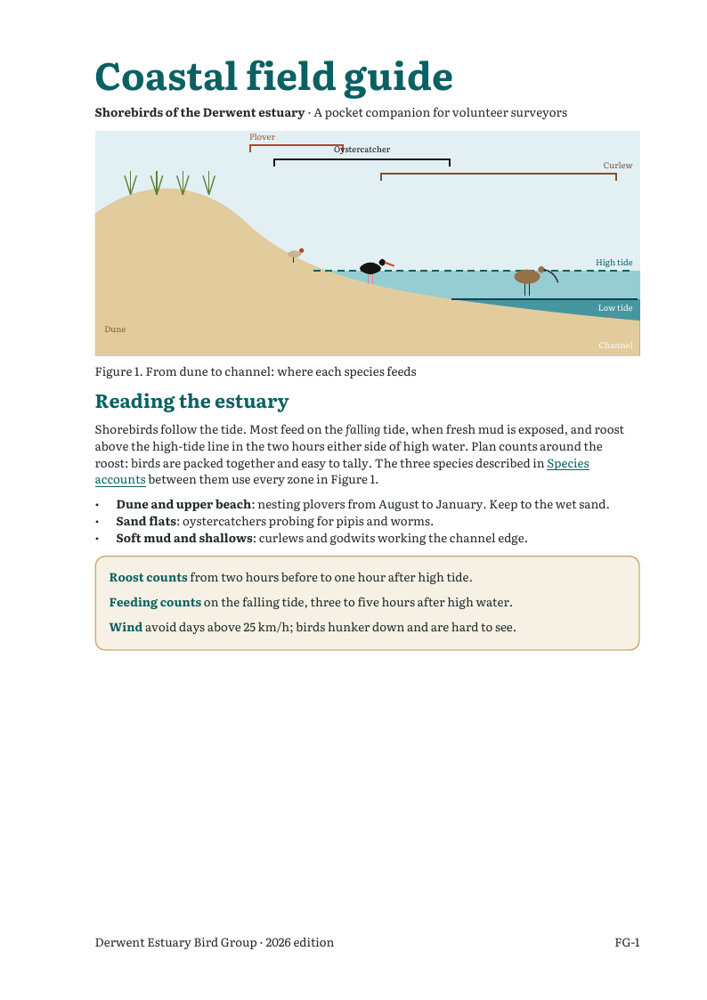
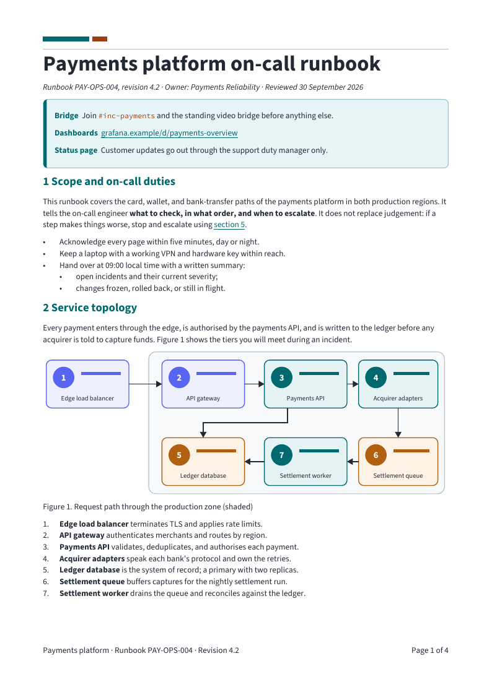
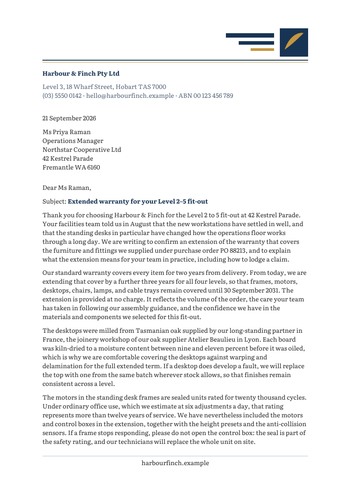
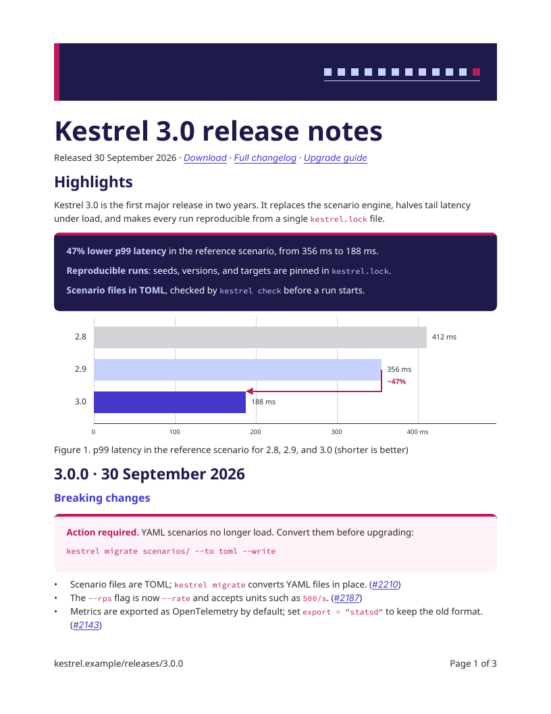
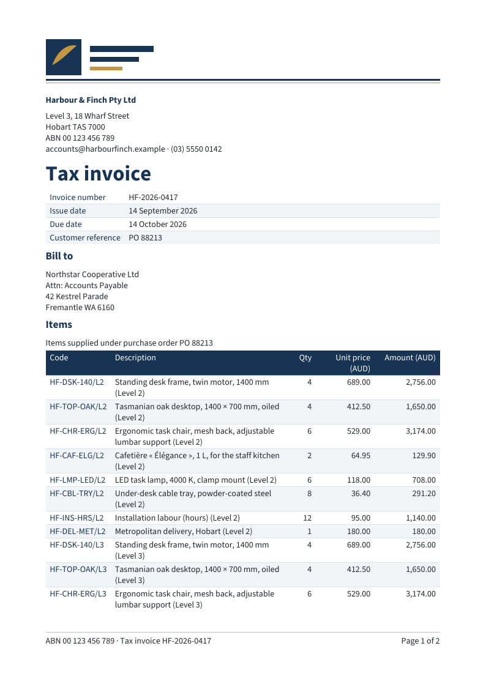
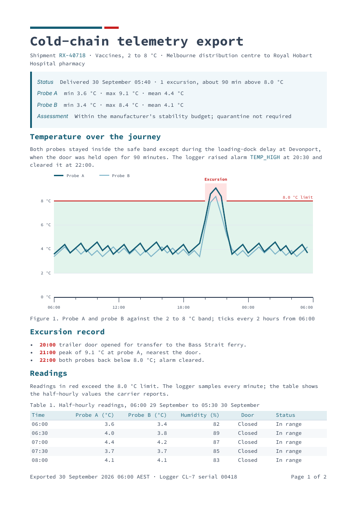
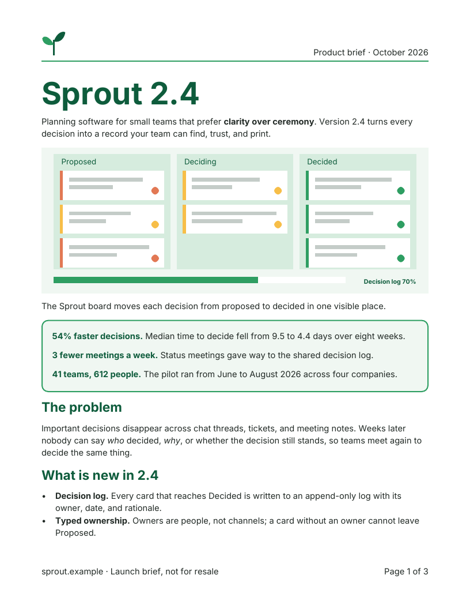
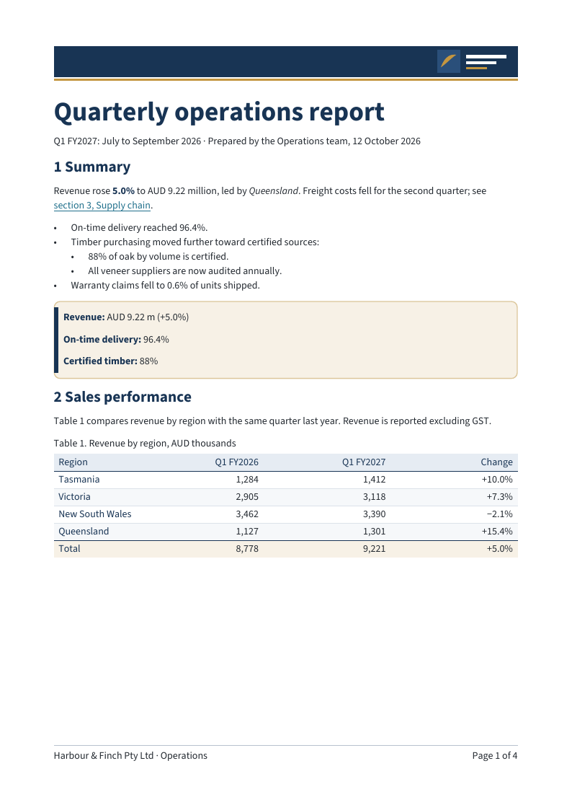

# roc-pdf

A pure [Roc](https://www.roc-lang.org/) package for deterministic PDF 2.0
generation.

The package offers a stable public authoring path whose default profile is
`Archive`: `Pdf.to_bytes`, `Pdf.to_bytes_with`, and `Pdf.to_chunks_with` all
produce deterministic tagged PDF 2.0 output that also claims static PDF/A-4,
and the buffered and chunked forms are byte-identical. `Standard` (PDF 2.0
only) remains available through the options' `profile` field
(`Pdf.to_bytes_with(document, { profile: Standard })`), and the options'
`compression` field trades generation time for file size: `Balanced` by
default, `Smallest` for the smallest files, or `Fastest`. The built-in theme supports title, heading,
paragraph, and bulleted-list constructors, with either the packaged face or
caller-registered faces selected through `Theme` — including a finite ordered
multi-face policy with per-cluster coverage selection. Theme text colors use
the packaged sRGB profile. Documents can be prepared once into an opaque,
validated plan and then emitted as buffered bytes or chunks. It does not read,
edit, or repair PDFs, and unsupported requests return typed errors rather than
producing blank output, substituting fonts, outlining text, or rasterizing
content.

Running headers and footers can use independent typography while body, list,
and table text keep their own style:

```roc
theme : Theme
theme = {
    body: { size: 11, leading: 15 },
    furniture: Own({ size: 8, leading: 10, color: Color.srgb8({ red: 80, green: 80, blue: 80 }) }),
}
```

`Theme.furniture` defaults to `BodyStyle`, inheriting the current body style.
`Own` accepts the same face, size, leading, and color fields as `Theme.BodyStyle`;
`face: Face(registered_face)` selects a registered face under `StyleFaces`.
Ordered font policies keep selecting each cluster from their declared faces.
Page fields and reserved widths use the furniture style, and text that exceeds
a field or region returns a diagnostic without shrinking, wrapping, or clipping.

For technical manuals, print destination page numbers, give chapters distinct
opening pages and running headers, and keep code, figures and tables inside
numbered instructions. Callouts can continue across pages with their panels.
Prepared vector diagrams use the public drawing API. See
[Composing a technical manual](docs/manual-composition.md) for usage and limits.

Default output claims static PDF/A-4 (`Pdf20 + StaticPdfA4`). The package
validates the requested profile before emitting any byte. A document that
cannot meet the claim returns a structured error; it is never
downgraded to `Standard`. PDF/UA-2 is not claimed yet: `AccessibleArchive`
deliberately returns a structured feature diagnostic, so do not make
accessibility-conformance claims from it. Automatic hyphenation is not
accepted, and the convenience shaping path covers a declared script set;
right-to-left and case-transformation output are available at the advanced
integration boundary rather than through the one-import facade.

The package exposes the high-level `Pdf` facade plus the advanced conceptual
`Document`, `Semantics`, `Layout`, `Scene`, `Text`, `Font`, `Image`, `Color`,
`Metadata`, `Encode`, `Conformance`, and `Theme` boundaries. PDF object,
lowering, and serialization internals are not public.

Use `Pdf.figure` for packed-raster or JPEG images and solid vector drawings,
including grouped drawings and searchable labels. Figures require alternative
text and accept an optional caption. Fixed-page composition and unsupported
drawing effects return located feature diagnostics. See the
[authoring support matrix](docs/authoring.md#supported-features).

The [0.1.0 release notes](docs/releases/0.1.0.md) summarize what this
release supports, its known limits, and how to upgrade from a release
candidate.

## Install

Add the 0.1.0 release bundle to your application header and build with the
Roc nightly named in the [0.1.0 release notes](docs/releases/0.1.0.md):

```roc
pdf: "https://github.com/lukewilliamboswell/roc-pdf/releases/download/0.1.0/TODO(release)-bundle-hash.tar.zst",
```

Then `import pdf.Pdf`. The [authoring guide](docs/authoring.md) starts from
a complete document.

## Start here

- [Authoring guide](docs/authoring.md)
- [Example gallery](examples/README.md)
- [Composing a technical manual](docs/manual-composition.md)
- [Destination page references](docs/destination-page-references.md)
- [Generated API documentation](https://lukewilliamboswell.github.io/roc-pdf/)
- [Release notes](docs/README.md#release-notes)

## Examples

Click a preview to open the generated PDF, or its caption to view the complete
runnable Roc source.

<table>
<tr>
<td><a href="examples/quarterly-report/quarterly-report.pdf"></a><br><a href="examples/quarterly-report/main.roc">Quarterly report source</a></td>
<td><a href="examples/brand-brief/brand-brief.pdf"></a><br><a href="examples/brand-brief/main.roc">Brand brief source</a></td>
<td><a href="examples/field-guide/field-guide.pdf"></a><br><a href="examples/field-guide/main.roc">Field guide source</a></td>
</tr>
<tr>
<td><a href="examples/operations-handbook/operations-handbook.pdf"></a><br><a href="examples/operations-handbook/main.roc">Operations handbook source</a></td>
<td><a href="examples/warranty-letter/warranty-letter.pdf"></a><br><a href="examples/warranty-letter/main.roc">Business letter source</a></td>
<td><a href="examples/release-notes/release-notes.pdf"></a><br><a href="examples/release-notes/main.roc">Release notes source</a></td>
</tr>
<tr>
<td><a href="examples/tax-invoice/tax-invoice.pdf"></a><br><a href="examples/tax-invoice/main.roc">Tax invoice source</a></td>
<td><a href="examples/chunked-export/chunked-export.pdf"></a><br><a href="examples/chunked-export/main.roc">Chunked export source</a></td>
<td><a href="examples/product-brief/product-brief.pdf"></a><br><a href="examples/product-brief/main.roc">Product brief source</a></td>
</tr>
<tr>
<td><a href="examples/business-report/business-report.pdf"></a><br><a href="examples/business-report/main.roc">Business report source</a></td>
</tr>
</table>

[See what each application demonstrates and how to run it.](examples/README.md)

## Design

- [Architecture](architecture.md)
- [Feature roadmap](feature-roadmap.md)

## Requirements

- Python 3
- Zig 0.16.0
- The Roc nightly pinned in [`.roc-version`](.roc-version), available as `roc` on `PATH`

## Development

Run the complete test suite with the pinned Roc compiler:

```sh
./scripts/test.py
```

See the [contributor documentation](development/README.md) for testing,
implementation contracts, performance evidence and release validation.

## License

This project is licensed under the [Universal Permissive License](LICENSE).
