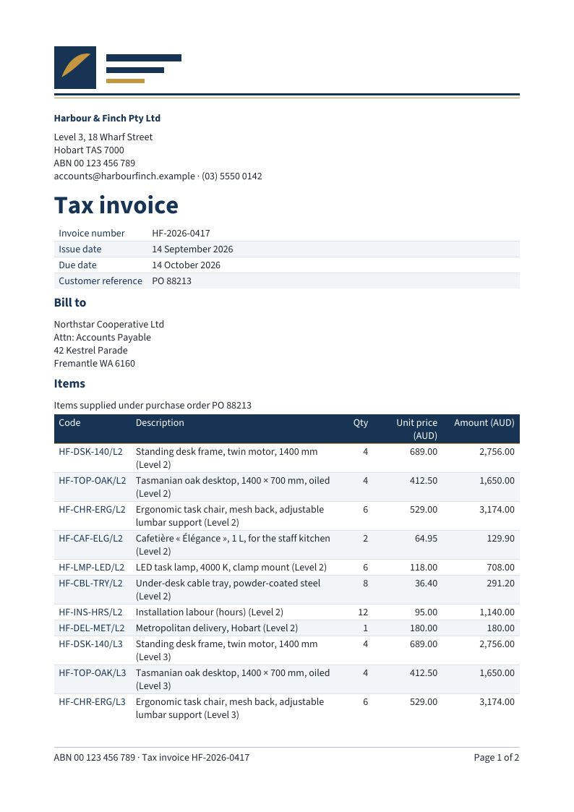
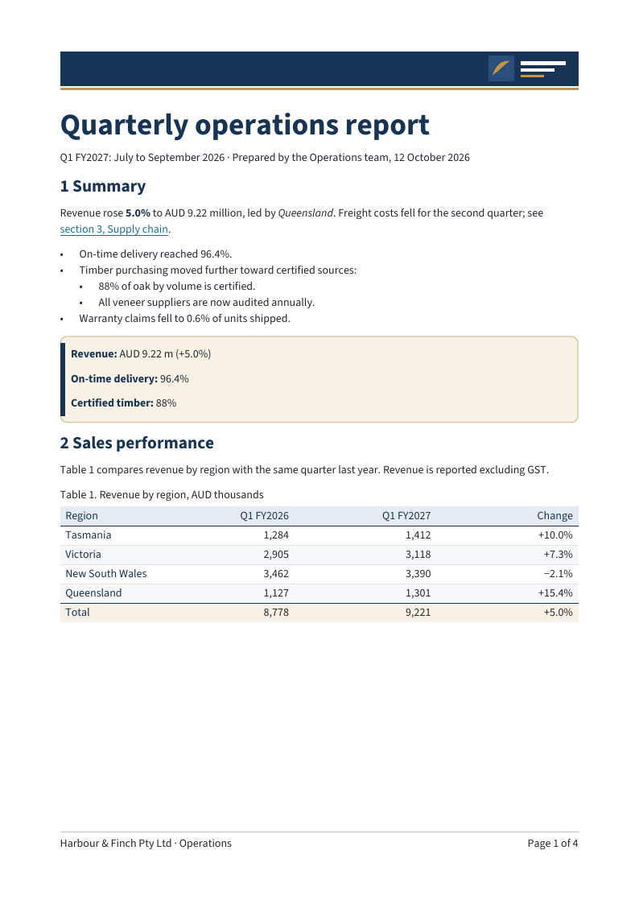
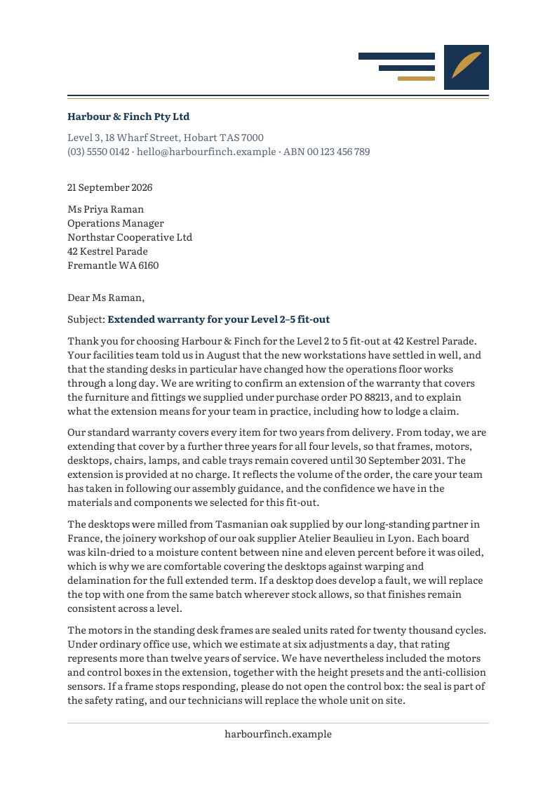

# roc-pdf

Generate searchable PDF 2.0 reports, invoices and letters from pure
[Roc](https://www.roc-lang.org/). Author text, tables and figures with the `Pdf`
facade; roc-pdf owns pagination, font embedding and deterministic output.

**[Read the manual](https://lukewilliamboswell.github.io/roc-pdf/manual/)** ·
[API reference](https://lukewilliamboswell.github.io/roc-pdf/) ·
[Latest release](https://github.com/lukewilliamboswell/roc-pdf/releases/latest)

The default `AccessibleArchive` profile claims static PDF/A-4 and PDF/UA-2
for supported documents. See [output profiles](docs/authoring.adoc#authoring-output-profiles)
to choose a different profile or add a WTPDF accessibility declaration.

<table>
<tr>
<td><a href="examples/tax-invoice/tax-invoice.pdf"></a><br><a href="examples/tax-invoice/main.roc">Tax invoice source</a></td>
<td><a href="examples/business-report/business-report.pdf"></a><br><a href="examples/business-report/main.roc">Business report source</a></td>
<td><a href="examples/warranty-letter/warranty-letter.pdf"></a><br><a href="examples/warranty-letter/main.roc">Business letter source</a></td>
</tr>
</table>

[Browse the complete example gallery.](examples/README.md)

## Install

Copy the package dependency URL and compiler requirement from the
[release you choose](https://github.com/lukewilliamboswell/roc-pdf/releases),
then follow its linked authoring guide. The manual explains
[how to create your first document](docs/getting-started.adoc).

To run an example from this checkout, use the compiler named in
[`.roc-version`](.roc-version) and run:

```sh
roc examples/tax-invoice/main.roc
```

This writes `tax-invoice.pdf` in the current directory. For contributor setup,
testing and release procedures, start with the
[contributing chapter](docs/contributing.adoc).

[Release notes](https://github.com/lukewilliamboswell/roc-pdf/releases) ·
[Universal Permissive License](LICENSE)
